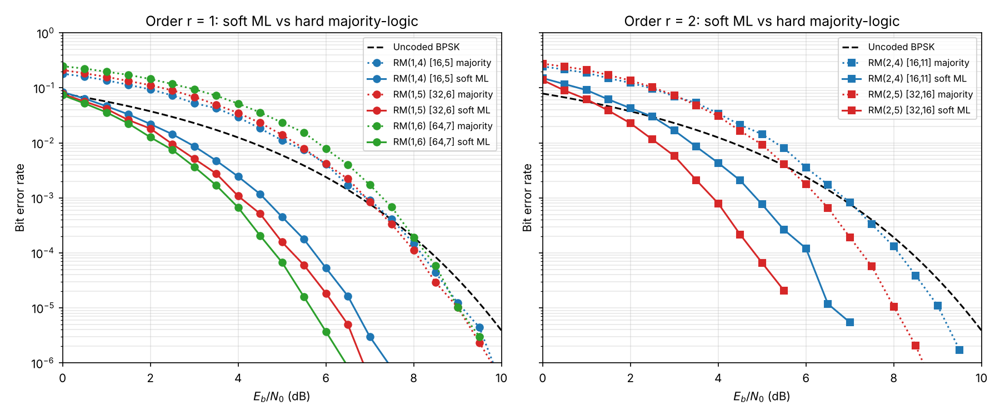
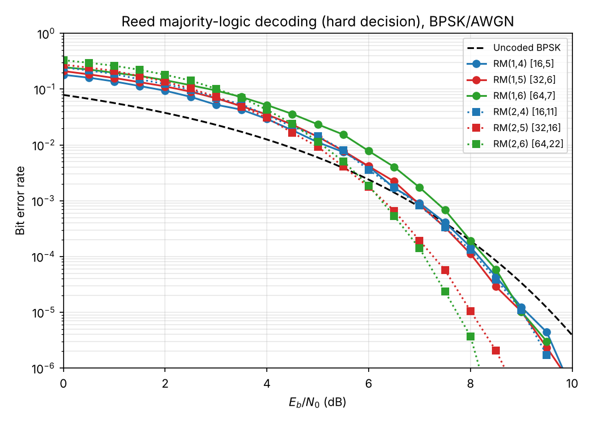
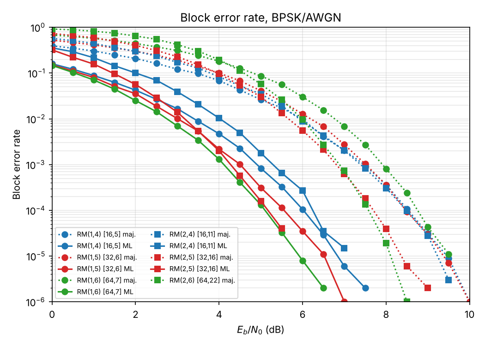
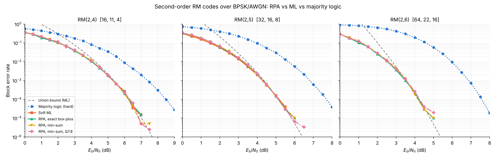
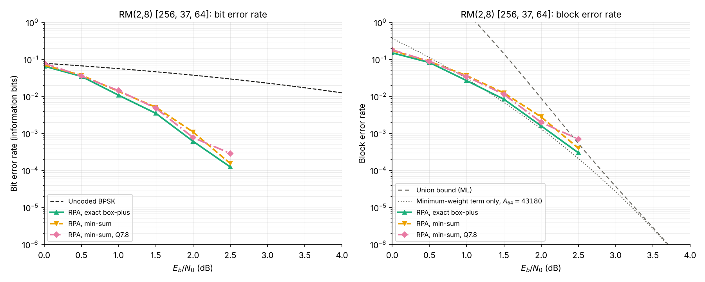
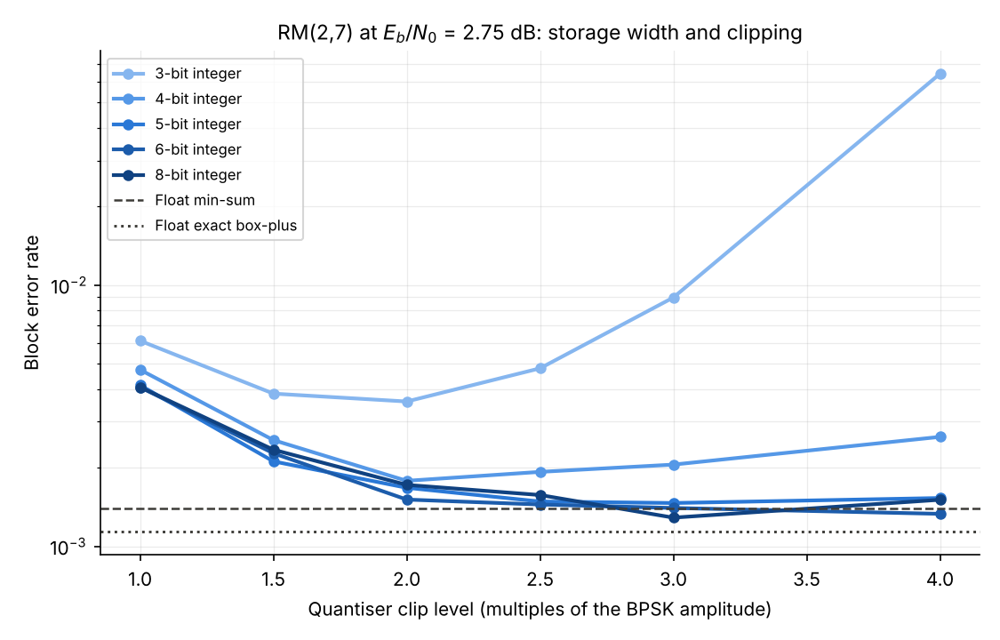
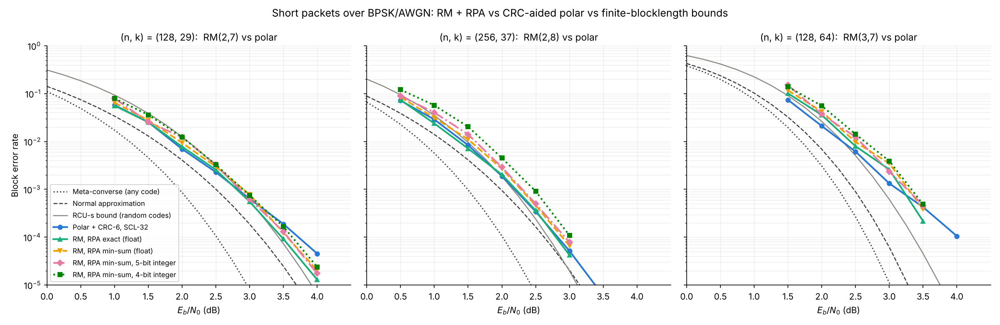

# Reed-Muller Codes: Encoding, Decoding and BER Simulation

A NumPy implementation of binary Reed-Muller codes RM(r, m), with Reed's majority-logic decoder, soft-decision maximum-likelihood decoders, and Monte Carlo BER / block-error-rate simulations over the BPSK/AWGN channel.

## Results

All curves are BPSK over AWGN, with BER measured on the information bits. Each point runs until 300 block errors are seen or the block budget is used up (1,000,000 blocks for majority-logic and FHT decoding, 200,000 for brute-force ML).



Required Eb/N0 for BER = 10⁻⁴ (uncoded BPSK needs 8.40 dB):

| Code | [n, k, d] | Rate | Majority-logic (hard) | Soft ML | Soft-decision advantage |
| --- | --- | --- | --- | --- | --- |
| RM(1,4) | [16, 5, 8] | 0.31 | 8.16 dB (gain 0.24 dB) | 5.74 dB (gain 2.66 dB) | 2.42 dB |
| RM(1,5) | [32, 6, 16] | 0.19 | 8.04 dB (gain 0.36 dB) | 5.23 dB (gain 3.16 dB) | 2.81 dB |
| RM(1,6) | [64, 7, 32] | 0.11 | 8.28 dB (gain 0.12 dB) | 4.82 dB (gain 3.58 dB) | 3.46 dB |
| RM(2,4) | [16, 11, 4] | 0.69 | 8.11 dB (gain 0.29 dB) | 6.04 dB (gain 2.36 dB) | 2.07 dB |
| RM(2,5) | [32, 16, 8] | 0.50 | 7.27 dB (gain 1.13 dB) | 4.82 dB (gain 3.57 dB) | 2.45 dB |
| RM(2,6) | [64, 22, 16] | 0.34 | 7.09 dB (gain 1.30 dB) | — | — |

Values are interpolated between simulated points. Soft ML for RM(2,6) is not shown because brute-force decoding over 2²² codewords is impractical.

**Observations**

- **Soft decisions matter most for low-rate codes.** First-order codes gain almost nothing with hard majority-logic decoding at BER 10⁻⁴ (their low rate costs nearly as much as the error correction recovers), but 2.7–3.6 dB with soft ML.
- **Under ML decoding, longer first-order codes keep improving** (RM(1,4) → RM(1,6) gains about 0.9 dB). Under hard majority-logic decoding they don't, because the rate loss grows as fast as the correction capability.
- **Second-order codes are the better trade-off for hard decoding.** RM(2,5) and RM(2,6) reach about 1.1–1.3 dB of gain with majority logic, thanks to their higher rate.
- **RM(2,5) with soft ML matches RM(1,6)** at BER 10⁻⁴ (4.82 dB) while carrying more than twice as many information bits per block (16 vs 7).





The raw numbers are in [`results/results.csv`](results/results.csv).

### RPA decoding of second-order codes



Eb/N0 (dB) for block error rate 10⁻⁴, interpolated:

| Code | Majority logic | Soft ML | RPA | RPA min-sum | RPA min-sum Q7.8 | Union bound |
| --- | --- | --- | --- | --- | --- | --- |
| RM(2,4) | 8.49 | 6.24 | 6.24 | 6.23 | 6.31 | 6.26 |
| RM(2,5) | 7.69 | 5.17 | 5.12 | 5.13 | 5.13 | 5.15 |
| RM(2,6) | 7.58 | — | 4.21 | 4.16 | 4.26 | 4.21 |

- **RPA is effectively ML for these codes.** On RM(2,4) and RM(2,5) its curve lies on top of brute-force ML, and on RM(2,6), where brute force is out of reach, it sits on the union bound.
- **Soft RPA beats hard majority logic by 2.2–3.4 dB** at block error rate 10⁻⁴, and the gap widens with length.
- **Min-sum and 16-bit Q7.8 storage cost nothing measurable** here. Near 10⁻⁴ the points rest on 3–90 block errors, so differences under about 0.1 dB are noise.



RM(2,8) is the [256, 37, 64] code from the CPA hardware study. With 10,000-block caps the curves stop at 2.5 dB; the union bound carries the picture further.

| Eb/N0 | 1.0 dB | 1.5 dB | 2.0 dB | 2.5 dB |
| --- | --- | --- | --- | --- |
| RPA, BER | 1.1×10⁻² | 3.5×10⁻³ | 6.1×10⁻⁴ | 1.2×10⁻⁴ |
| RPA, BLER | 2.7×10⁻² | 8.4×10⁻³ | 1.6×10⁻³ | 3×10⁻⁴ (3 errors) |
| RPA min-sum, BLER | 3.7×10⁻² | 1.2×10⁻² | 2.8×10⁻³ | 4×10⁻⁴ (4 errors) |
| RPA min-sum Q7.8, BLER | 3.4×10⁻² | 1.1×10⁻² | 2.0×10⁻³ | 7×10⁻⁴ (7 errors) |
| Uncoded BPSK, BER | 5.6×10⁻² | 4.7×10⁻² | 3.8×10⁻² | 3.0×10⁻² |

At 1.0–1.5 dB, where the counts are large (84–219 block errors), min-sum costs about 0.1–0.15 dB against exact box-plus, and Q7.8 adds nothing beyond min-sum. Exact RPA follows the minimum-weight term of the union bound, 43,180·Q(√(2R·64·Eb/N0)), closely from 1 dB up.

The RPA numbers are in [`results/results_rpa.csv`](results/results_rpa.csv), produced by `simulate_rpa.py --m 4 5 6` (seed 2026) and `simulate_rpa.py --m 8 --seed 2027`, run as two parallel jobs.

### Fixed-point RPA: provable word lengths

Statements and proofs are in [`docs/theory.md`](docs/theory.md). In summary:

- **Theorem 1 (scale invariance).** Min-sum RPA gives the same decisions for L and cL, c > 0. So the receiver needs no noise-variance estimate (it can quantise y directly), and *normalised* min-sum is identical to plain min-sum for RPA.
- **Theorem 2 (codeword symmetry).** With an odd quantiser, symmetric rounding and random tie-breaking, the integer decoder's error probability does not depend on the transmitted codeword. Without random tie-breaking it does, because integer FHT spectra tie with positive probability.
- **Theorem 3 (word lengths).** For min-sum RPA on RM(r, m) with b-bit stored LLRs and shift-by-m renormalisation, b bits of storage, b + m − r + 1 bits for the FHT and b + m bits for the aggregation accumulator are enough for every input. A worst-case input reaches every bound, so for b ≥ 3 no width can be reduced.

`cpp/sim width` checks this (`results/cpp/width_check.txt`; the tests assert it):

| Code, storage | FHT bound / bits | Aggregation bound / bits | Largest seen on noisy inputs |
| --- | --- | --- | --- |
| RM(2,8), 5-bit | 1,920 / 12 | 3,825 / 13 | 1,024 and 2,040 |
| RM(2,8), 6-bit | 3,968 / 13 | 7,905 / 14 | 1,953 and 4,015 |
| RM(3,7), 5-bit | 480 / 10 | 1,905 / 12 | 288 and 1,143 |
| RM(2,8), 16-bit (Q7.8) | 4,194,176 / 23 | 8,355,585 / 24 | 2,228,761 and 4,509,910 |

So a 5- or 6-bit min-sum RPA decoder for RM(2,8) runs entirely in 16-bit integer arithmetic with no overflow handling, while 16-bit Q7.8 storage forces 32-bit accumulators.



On RM(2,7), 5-bit storage matches floating-point min-sum within the simulation noise, 4 bits costs about 0.1 dB and 3 bits about 0.3 dB (converted from the BLER ratios using the local slope of the curve). Clipping at about 2× the received RMS (what an AGC measures) works for all three codes.

### Short-packet benchmark against polar codes and finite-blocklength bounds

All runs use the C++ engine (`cpp/`). Each RM code is compared with a CRC-aided polar code of the same (n, k): Gaussian-approximation construction, CRC length chosen by a sweep (CRC-6 was best for all three, `results/cpp/polar_crc_sweep.csv`), and SCL decoding with list size 32. The bounds are for the BI-AWGN channel with uniform inputs, computed rigorously on a lattice (`rmcodes/fbl.py`, checked against Monte Carlo in the tests).



Eb/N0 (dB) for block error rate 10⁻³, and for 10⁻⁴ where the simulations reach it:

| (n, k) | Meta-converse | Normal approx. | RCU_s | Polar CRC-SCL32 | RM, RPA exact | RM, RPA min-sum | RM, 5-bit integer | RM, 4-bit integer |
| --- | --- | --- | --- | --- | --- | --- | --- | --- |
| (128, 29), 10⁻³ | 1.96 | 2.50 | 2.85 | 2.82 | **2.81** | 2.91 | 2.86 | 2.90 |
| (128, 29), 10⁻⁴ | 2.52 | 3.17 | 3.43 | 3.72 | **3.48** | 3.56 | 3.57 | 3.63 |
| (256, 37), 10⁻³ | 1.50 | 1.99 | 2.16 | **2.19** | 2.21 | 2.28 | 2.30 | 2.47 |
| (256, 37), 10⁻⁴ | 2.01 | 2.63 | 2.69 | 2.83 | **2.80** | 2.89 | 2.94 | — |
| (128, 64), 10⁻³ | 2.25 | 2.48 | 2.90 | **3.13** | 3.19 | 3.28 | 3.26 | 3.33 |

Findings:

- **Low rate, n = 128.** RM(2,7) with RPA ties the polar code at 10⁻³ and is 0.24 dB better at 10⁻⁴: its curve is steeper (d = 32). It stays within 0.05 dB of the random-coding RCU_s bound at both error rates.
- **(256, 37).** RM(2,8) and the polar code are within 0.03 dB at both error rates.
- **Rate ½.** Plain RPA on RM(3,7) is about 0.06 dB behind the polar code at 10⁻³, within the statistical precision of these runs (50 block errors). RPA list decoding, not implemented here, is the known fix.
- **Hardware variants.** Min-sum costs 0.07–0.1 dB. 5-bit integer storage adds nothing measurable beyond that on RM(2,7) and RM(3,7), and about 0.02–0.05 dB on RM(2,8). 4 bits is enough at n = 128 but costs about 0.2 dB on RM(2,8), whose per-symbol SNR is lowest.
- **The normal approximation is a poor reference at low rate.** At (128, 29) it sits 0.54 dB above the rigorous meta-converse, so gaps quoted to the normal approximation alone overstate how far a code is from optimal. The table reports both.

Precision: each point stops at 100 block errors (50 for RM(3,7)) or at its block cap; `results/benchmark_table.csv` lists the error counts at the points bracketing each crossing. The table's simulated values are log-linear interpolations; differences under about 0.05 dB are not significant.

## Background

RM(r, m) is the set of evaluation vectors of all Boolean polynomials in m variables of degree at most r, evaluated at the 2^m points of GF(2)^m.

- Length n = 2^m, dimension k = Σ_{i=0}^{r} C(m, i), minimum distance d = 2^(m−r)
- RM(1, m) is the first-order (biorthogonal) code; RM(m−2, m) is the extended Hamming code
- The generator matrix has one row per monomial of degree ≤ r (`rmcodes/code.py`)

## Decoders

**Reed majority-logic decoding (hard decision)** — `MajorityLogicDecoder`

Decodes coefficients from the highest degree down. For a degree-d monomial, summing the received word over any coset of the subspace spanned by that monomial's variables gives the monomial's coefficient: every other term of degree ≤ d sums to zero over the coset, and higher-degree terms have already been subtracted. The 2^(m−d) cosets give 2^(m−d) independent votes, and the coefficient is their majority. This corrects every error pattern of weight up to 2^(m−r−1) − 1, which the tests verify.

**Soft ML for first-order codes** — `ml_decode_rm1`

The BPSK images of RM(1, m) codewords are ±(−1)^(a·x), so correlating the received vector with all 2^(m+1) codewords is just a Walsh–Hadamard transform. The ML codeword maximises |FHT(y)[a]|, in O(n log n).

**Soft ML by exhaustive search** — `BruteForceMLDecoder`

Correlates with all 2^k codewords and picks the best. Used for RM(2,4) and RM(2,5) (k ≤ 16).

**Recursive projection-aggregation (RPA)** — `RPADecoder` (`rmcodes/rpa.py`)

The soft decoder of Ye and Abbe, *Recursive projection-aggregation decoding of Reed-Muller codes* (IEEE Trans. IT 2020, arXiv:1902.01470), Algorithms 3–4. The paper writes RM(m, r) for what this repository calls RM(r, m).

- *Projection.* For a direction b ≠ 0, the cosets {z, z+b} carry the bits c(z) + c(z+b) = (D_b f)(z), the discrete derivative of the codeword polynomial f. Because deg D_b f ≤ r − 1 and D_b f is constant on each coset, the projected word is a codeword of RM(r−1, m−1) (Lemma 1 of the paper). For r = 2 this is explicit: f(z+b) + f(z) = bUzᵀ + const, with U the symmetric matrix of quadratic coefficients (eq. 8.6 of Abbe, Sberlo, Shpilka, Ye, *Reed-Muller Codes*).
- *Projected LLR.* Any two coordinates of a uniformly random RM codeword are independent uniform bits (Lemma 2), so the LLR of c(z) + c(z+b) is the box-plus L₁ ⊞ L₂ = ln(e^(L₁+L₂) + 1) − ln(e^(L₁) + e^(L₂)) = 2 artanh(tanh(L₁/2) tanh(L₂/2)).
- *Min-sum.* sign(L₁)sign(L₂)min(|L₁|, |L₂|) satisfies L₁ ⊞ L₂ = min-sum + ln(1 + e^(−|L₁+L₂|)) − ln(1 + e^(−|L₁−L₂|)). The correction lies in [−ln 2, ln 2] and opposes the sign of the min-sum term, so min-sum is off by at most ln 2 and always overstates reliability (checked in the tests).
- *Recursion and aggregation.* Each of the n − 1 projections is decoded as RM(r−1, m−1), down to RM(1, ·), which uses the FHT ML decoder. Each decoded projection votes (1 − 2ŷ_b)·L(z+b) for L(z); the new LLR is the average of the n − 1 votes. This repeats up to ⌊m/2⌋ times or until every LLR moves by less than 5 %.
- *Complexity.* O(nʳ log n) (Proposition 3). For r = 2, one round costs (n−1)·n/2 box-plus operations, (n−1)·(n/2)·log₂(n/2) FHT additions and (n−1)·n aggregation additions; for RM(2,8) that is 32,640 + 228,480 + 65,280 per round per block.
- *Codeword symmetry.* The error probability does not depend on the transmitted codeword (Proposition 4), because every step commutes with flipping LLR signs along a codeword. This also holds for min-sum and for a fixed-point quantiser that is an odd function, which is why `make_quantizer` saturates at ±(2¹⁵ − 1), not at −2¹⁵. The tests check the symmetry directly.
- For r = 2 there is only one recursion level, so collapsed projection-aggregation (CPA) is the same algorithm as RPA.

`RPADecoder(code, min_sum=True, llr_format=(7, 8))` emulates Q7.8 storage: channel, projected and aggregated LLRs are all rounded to steps of 1/256 and saturated at ±127.996. It does not model accumulator width; the integer decoder in `cpp/` does, and Theorem 3 of [`docs/theory.md`](docs/theory.md) shows that Q7.8 storage needs 23-bit FHT and 24-bit aggregation accumulators for RM(2,8).

The decoder outputs a hard decision on the final LLRs, which need not be a codeword; it is mapped to a message with Reed's decoder (exact when the output is a codeword).

## Weight distributions and the union bound

`rmcodes/bounds.py` gives an ML benchmark that needs no simulation.

- Minimum-weight codewords of RM(r, m) are the indicators of (m−r)-flats, and there are A_d = 2^r ∏_{i=0}^{m−r−1} (2^(m−i) − 1)/(2^(m−r−i) − 1) of them. For RM(2,8), A₆₄ = 43,180.
- For r = 2 the full distribution is Sloane–Berlekamp: a quadratic form of rank 2h has weight 2^(m−1) ± 2^(m−1−h), and each of these weights occurs 2^(h(h+1)) ∏_{i=m−2h+1}^{m}(2^i − 1) / ∏_{i=1}^{h}(4^i − 1) times. The tests check this against exhaustive enumeration for m = 3…6.
- Union bound on ML block error rate over BPSK/AWGN: P_B ≤ Σ_w A_w Q(√(2R·w·Eb/N0)). Keeping only w = d gives the truncated bound, a close estimate of ML performance at high SNR.

## Repository layout

```
rmcodes/
├── code.py        # ReedMullerCode: parameters, generator matrix, encoder
├── decoders.py    # majority-logic, FHT-based ML, brute-force ML
├── rpa.py         # RPA decoder, box-plus / min-sum, fixed-point emulation
├── bounds.py      # weight distributions, union bounds
└── fbl.py         # finite-blocklength bounds: meta-converse, normal approx., RCU_s, DT
cpp/
├── rm.hpp         # RM encoder (same conventions as rmcodes/code.py)
├── rpa.hpp        # float RPA (exact / min-sum) and integer min-sum RPA with width tracking
├── polar.hpp      # CRC-aided polar codes: GA construction, SCL decoder
├── sim.cpp        # Monte Carlo driver, width checker, decoder for cross-checks
└── Makefile
docs/
└── theory.md      # theorems and proofs (scale invariance, symmetry, word lengths, bounds)
scripts/
├── simulate.py    # Monte Carlo BER/BLER simulation -> results/results.csv
├── simulate_rpa.py# RPA simulation for RM(2,4..6) and RM(2,8) -> results/results_rpa.csv
├── plot.py        # results/ber_*.png, bler_all.png
├── plot_rpa.py    # results/bler_rpa_r2.png, rm28_rpa.png
├── run_cpp_benchmark.sh # C++ short-packet benchmark -> results/cpp/bench_*.csv
├── fbl_benchmark.py     # bounds -> results/fbl_thresholds.csv, fbl_curves.csv
└── plot_benchmark.py    # results/benchmark_bler.png, fixed_point_sweep.png, benchmark_table.csv
tests/
├── test_rm.py     # parameters, minimum distance, error-correction guarantee, ML checks
├── test_rpa_bounds.py # box-plus bounds, quantiser, weight distributions, RPA checks
├── test_fbl.py    # Shannon-limit check, bounds vs Monte Carlo, bound ordering
└── test_cpp.py    # C++ vs Python decisions, proven word lengths never exceeded and attained
results/           # CSV and plots from the runs above
```

## Running it

```bash
pip install -r requirements.txt

python -m pytest tests                       # 68 tests, under a minute (builds cpp/sim)
PYTHONPATH=. python scripts/simulate.py      # full simulation, a few minutes
PYTHONPATH=. python scripts/simulate.py --quick
PYTHONPATH=. python scripts/plot.py

PYTHONPATH=. python scripts/simulate_rpa.py  # RPA runs; RM(2,8) is the slow part
PYTHONPATH=. python scripts/simulate_rpa.py --m 4 5 --quick
PYTHONPATH=. python scripts/plot_rpa.py

make -C cpp                                  # C++ engine (g++ with C++17)
cpp/sim rpa --r 2 --m 8 --dec fixed --bits 5 --clip-rms 2.0 --ebn0 1,2 --target 100
cpp/sim width --r 2 --m 8 --bits 5 --ebn0 1,2,3   # proven vs observed word lengths
scripts/run_cpp_benchmark.sh all             # short-packet benchmark, ~3 h on 2 cores
PYTHONPATH=. python scripts/fbl_benchmark.py # finite-blocklength bounds, ~15 min
PYTHONPATH=. python scripts/plot_benchmark.py
```

`simulate.py` options include `--ebn0 START STOP STEP`, `--target-errors`, `--max-blocks` and `--seed`. Results are reproducible with the default seed.

## Possible extensions

- RPA list decoding (Ye–Abbe Section III), which should close most of the RM(3,7) gap to the bounds, and Dumer's recursive (Plotkin-structure) decoding for comparison
- Hard-decision ML (minimum Hamming distance) decoding, to separate the soft-vs-hard gain from the majority-logic loss
- Offset min-sum: by Theorem 1 in `docs/theory.md`, only non-homogeneous corrections can change min-sum RPA decisions
- Running the integer decoder on a microcontroller (Cortex-M0/M4) and measuring latency, energy and memory
- Comparison with BCH and with 5G NR polar codes (5G reliability sequence and rate matching)
